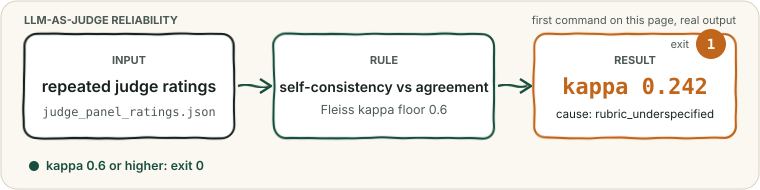

# judge-reliability-kit

**A low kappa says your LLM judge panel disagrees, but it does not say whether to fix the rubric or the task.**

Homayoun Safarpour

[](https://github.com/homayoun-safarpour/judge-reliability-kit/actions/workflows/ci.yml) [](https://www.python.org/downloads/) [](LICENSE)

LLM-as-judge reliability: diagnose why an LLM judge panel disagrees, so you know whether to fix the rubric or the task.

judge-reliability-kit is a Python package that reads repeated ratings from a panel of language-model judges and reports why the panel disagrees. We built it because a low kappa can come from ambiguous items or from an underspecified rubric, whereas the two causes need opposite fixes and give the same number. Given at least two ratings per judge per item, it compares how often each judge repeats itself with how often the judges agree, and gives every item one of four verdicts. It produces a Markdown report and exits 1 when the panel's Fleiss kappa is below 0.6, so that a CI job can refuse scores from an unreliable panel.

```bash
git clone https://github.com/homayoun-safarpour/judge-reliability-kit
cd judge-reliability-kit && pip install -e .
judgekit report examples/judge_panel_ratings.json
```

```text
# Judge panel reliability report

## Headline

- **Inter-judge Fleiss kappa:** 0.242 - fair - a shared construct may exist but the rubric is not carrying it
- **Mean intra-judge self-consistency:** 0.867
- **Dominant cause of disagreement:** `rubric_underspecified`
```

Those are the first lines of the report it prints. The rest adds the share of each cause, the self-consistency of each judge and the contested items, as in [`examples/report.md`](examples/report.md). That command exits 1, because 0.242 is below 0.6. Add `-o reliability.md` to write the report to a file.



[How it works](#how-it-works) · [Results](#what-each-result-means) · [Limits](#limits) · [Interview pack](docs/INTERVIEW.md) · [Cite](#citation) · Part of [a small open stack for checking AI agents and their judges](https://homayoun-safarpour.github.io)

## What each result means

| Result | Exit | Meaning |
|---|---|---|
| Fleiss kappa 0.6 or above | 0 | The judges agree with each other on a single pass. |
| Fleiss kappa below 0.6 | 1 | The panel is not reliable yet. The report names the dominant cause and an action for each contested item. |
| Bad input | 1 | Not a JSON object, one judge only, or one rating per judge per item. The command stops with an error message. |
| Missing or wrong arguments | 2 | Usage error from the command line parser. |

The exit code depends only on the single-pass kappa. Each item also gets a verdict in the report:

| Verdict | What the numbers show | What to change |
|---|---|---|
| `clean` | Every judge repeats itself, and the judges agree | Nothing |
| `item_ambiguous` | Mean self-consistency on the item is below 0.8 | The task: allow abstain, route to a human, or leave the item out of scoring |
| `rubric_underspecified` | Every judge repeats itself, but cross-judge consensus is below 0.6 | The rubric: pin the disputed clause and add a boundary example |
| `judge_unstable` | One judge's self-consistency across all items is below 0.4, and every item marked ambiguous is relabelled | The judge: lower the temperature, fix the prompt, or replace the model |

Exit 0 shows that the judges agree with each other. It does not show that they agree with a human or that their labels are correct. The claim limits are in [`docs/RELIABILITY_CARD.md`](docs/RELIABILITY_CARD.md).

## Use this when

| Situation | Use judge-reliability-kit? |
| --- | --- |
| Each judge rated each item at least twice, and you want to know why the panel disagrees | Yes |
| You want a CI step that fails when panel kappa falls below 0.6 | Yes |
| You have one rating per judge per item | Only for the agreement functions such as `fleiss_kappa`. The diagnosis refuses single-pass input |
| You want to know whether a judge changed over time against human anchors | No. Use [judge-drift-sentinel](https://github.com/homayoun-safarpour/judge-drift-sentinel) |
| You want a model to grade answers | No. This package never calls a model. [judge-field-guide](https://github.com/homayoun-safarpour/judge-field-guide) lists tools that do |

The package is not on PyPI yet. `pip install git+https://github.com/homayoun-safarpour/judge-reliability-kit` is the other way to install it, and `pip install -e ".[dev]"` adds pytest and ruff.

## The problem

A panel of LLM judges can look competent judge by judge and still reach a Fleiss kappa near 0.2 as a group. An ambiguous item has no single right label, so even one judge asked twice answers differently, and a new rubric will not help. With an underspecified rubric, each judge repeats itself but holds a different reading of the criterion, so more judges or more averaging will not help. A single kappa cannot tell the two apart. The test `tests/test_decompose.py::test_the_two_causes_produce_the_same_kappa_but_different_verdicts` builds one panel of each kind, both with a single-pass kappa below 0.25, and checks that they get opposite verdicts.

## How it works

The two causes become separable once each judge scores each item more than once. For each item, `decompose` first measures how often each judge repeats its own label (self-consistency), then how often the judges' most common labels match (consensus), and gives the verdicts in the table above. Self-consistency comes first, because judges that flip a coin often share a most common label by chance, and checking consensus first would mark those items `clean` (`test_modal_labels_cannot_rescue_an_unstable_panel`).

From Python, `ratings[item_id][judge_id]` is the list of repeated labels from that judge:

```python
from judgekit import decompose

ratings = {
    "REC001": {
        "gpt-4o":  ["include", "include", "include", "include"],
        "claude":  ["exclude", "exclude", "exclude", "exclude"],
        "llama":   ["include", "include", "include", "include"],
    },
    "REC002": {
        "gpt-4o":  ["include", "exclude", "include", "exclude"],
        "claude":  ["exclude", "include", "exclude", "include"],
        "llama":   ["include", "exclude", "exclude", "include"],
    },
}

result = decompose(ratings)
for item in result.items:
    print(item.item_id, item.verdict)
```

```text
REC001 rubric_underspecified
REC002 item_ambiguous
```

In REC001 every judge repeats itself and they still disagree, whereas in REC002 every judge contradicts itself.

`decompose` also reports the panel kappa on a single pass (`single_pass_kappa`) and after a majority vote over the repeats (`modal_kappa`). A large positive `majority_vote_inflation` means that the vote, and not the judges, produces the agreement.

| Module | What it does |
|---|---|
| `judgekit.agreement` | `fleiss_kappa`, `cohen_kappa`, `krippendorff_alpha` (skipped items as `None`), `pairwise_kappas`, `percent_agreement`, and `interpret_kappa` (Landis and Koch bands) |
| `judgekit.decompose` | Per-item verdicts with an action for each, plus intra-judge and inter-judge agreement for the panel |
| `judgekit.probes` | `position_bias`, `verbosity_bias` and `self_enhancement_bias`, which change one thing that should not matter and call your own `score_fn` or `compare_fn`, and `scale_direction_bias`, which reads recorded scores |
| `judgekit.report` | `markdown_report`, which opens with the diagnosis and the action |
| `judgekit.cli` | The `judgekit report` command and its exit code |

`percent_agreement` is kept to show how it misleads: two judges who say "exclude" on 49 of 50 items agree on 96% of them, yet their Cohen kappa is below zero (`test_imbalance_trap_high_percent_low_kappa`).

`python examples/worked_example.py` prints the bare kappa beside the decomposition, and `python examples/ambiguous_item_demo.py` shows one hedged item marked `item_ambiguous`. Both rewrite their output files in `examples/`.

### Scale-direction probe

`scale_direction_bias` asks whether a judge follows the rubric's meaning or just favours a large number. Score each item twice: once with the rubric as written, and once with the same rubric with the scale reversed, so that the best anchor carries the lowest number. The probe maps each reversed score back (`max + min - score`) and reports the mean absolute gap as a share of the scale width. It flags the judge at 0.10 or more, a tenth of the scale (0.4 points on 1 to 5). The idea comes from the scale-reversal probe in [arXiv:2611.25588](https://arxiv.org/abs/2611.25588).

```python
from judgekit import scale_direction_bias

scores = {"q1": (5, 5), "q2": (4, 5)}  # item: (normal scale, reversed scale)
print(scale_direction_bias(scores, scale_min=1, scale_max=5))
```

A judge that gives the top number on either scale is flagged (`test_scale_direction_flags_numeric_prior`), and a judge whose reversed scores map back exactly is not (`test_scale_direction_passes_faithful_judge`).

Interview pack: [docs/INTERVIEW.md](docs/INTERVIEW.md), five talking points and three questions.

## Limits

- It is not a judge or a benchmark. It never calls a model, so you bring the ratings, or a `score_fn` for the probes.
- The thresholds are starting points and are not calibrated for your label space. Self-consistency (0.8) and consensus (0.6) are command-line flags, whereas the 0.6 kappa for the exit code is fixed in the code. The report lists at most 20 contested items.
- `scale_direction_bias` needs the reversed-scale ratings to be collected: you run your judge a second time with the reversed rubric and pass in both scores. It does not apply the paper's floor normalisation against each judge's own run-to-run noise, so a noisy judge can be flagged for noise alone.
- The bundled panel is a small constructed example (36 items, three judges, four ratings each), not data from a production system.
- `examples/ambiguous_item_fixture.json` holds the item text beside the ratings, so `judgekit report` cannot read it directly. Use `examples/ambiguous_item_demo.py` for it.
- Its one runtime dependency is numpy, and it needs Python 3.10 or later. CI runs `ruff check src tests` and `pytest` on Python 3.10, 3.11 and 3.12.

## Use it as a gate in CI

```yaml
- name: Judge panel must be reliable before we ship scores
  run: judgekit report data/panel_ratings.json -o reliability.md
```

The step fails when the panel kappa is below 0.6, and `reliability.md` says which fix to make first.

## Related tools

- [judge-drift-sentinel](https://github.com/homayoun-safarpour/judge-drift-sentinel): tells judge drift from system change on a frozen anchor set.
- [judge-field-guide](https://github.com/homayoun-safarpour/judge-field-guide): a link-checked map of tools for LLM judges.

## Citation

Use the "Cite this repository" button on GitHub, or:

```bibtex
@software{safarpour_judge_reliability_kit_2026,
  author  = {Homayoun Safarpour},
  title   = {judge-reliability-kit: diagnosing why an LLM judge panel disagrees},
  year    = {2026},
  url     = {https://github.com/homayoun-safarpour/judge-reliability-kit},
  license = {MIT}
}
```

Author: Homayoun Safarpour · [LinkedIn](https://www.linkedin.com/in/homayoun-safarpour/)

## License

MIT. See [LICENSE](LICENSE).
